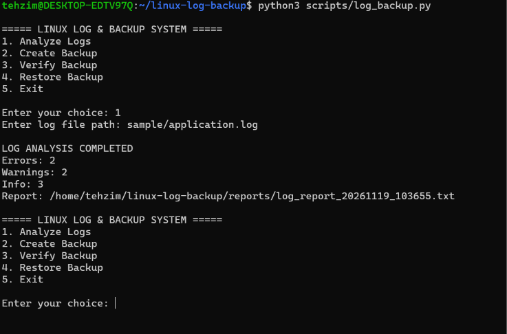
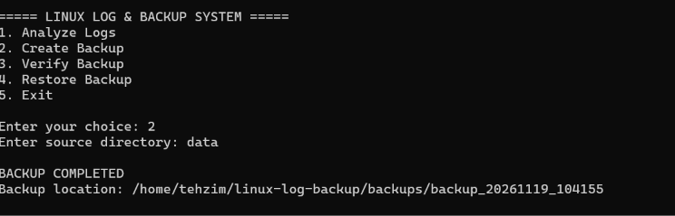
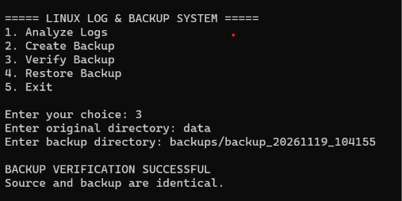
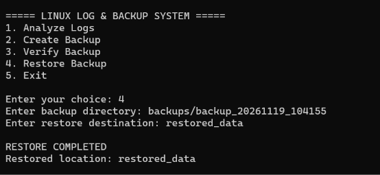

Linux Log Analyzer & Backup Automation

Project Overview

This project is a Python-based Linux system administration tool designed to analyze application logs and automate directory backup operations.

It helps identify system/application errors, generate reports, create backups, verify backup integrity through directory comparison, and restore backed-up data.

Features

- Log Analysis: Reads log files and identifies ERROR, WARNING, and INFO messages.
- Error Detection: Counts errors and displays error details.
- Warning Detection: Identifies warning messages.
- Report Generation: Automatically generates timestamped text reports.
- Automated Backup: Creates directory backups.
- Backup Verification: Compares original and backup directories using Linux diff.
- Backup Restoration: Restores backed-up directories to a new location.

Technologies Used

- Python 3
- Linux (Ubuntu / WSL2)
- Bash / Linux Commands
- Git & GitHub

Python Modules

- os
- pathlib
- subprocess
- shutil

Project Structure

linux-log-backup/
│
├── scripts/
│   └── log_backup.py
│
├── sample/
│   └── application.log
│
├── data/
│   └── config.txt
│
├── reports/
│
├── backups/
│
├── screenshots/
│
├── .gitignore
└── README.md

How to Run

Clone the repository:

git clone YOUR_REPOSITORY_URL
cd linux-log-backup

Run the program:

python3 scripts/log_backup.py

Available Operations

1. Analyze Logs
2. Create Backup
3. Verify Backup
4. Restore Backup
5. Exit

Testing Results

The project was tested successfully:

- Log analysis: 2 Errors, 2 Warnings, 3 Info messages detected.
- Backup creation: Successful.
- Backup verification: Successful.
- Backup restoration: Successful.

## Project Screenshots

### 01 Log Analysis

### 02 Backup Creation

###03 Backup verification

### 04 Backup Restoration

Learning Outcomes

- Linux file and directory management.
- Python scripting for system administration.
- Log analysis and troubleshooting.
- Backup and restore automation.
- Basic Linux command execution using Python.

Author

Tehzim Khan
